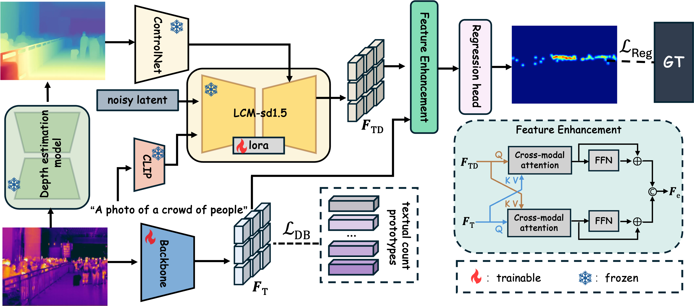

# TDCount: Making the RGB-T Crowd Counting Thermal-Only
Official implementation of 'TDCount: Making the RGB-T Crowd Counting Thermal-Only'



## Preparation

**Environment:** Create a virtural environment use Anaconda, and install all dependencies.
```
conda env create -f environment.yaml
```
**Data:** We conduct experiments over two datasets, you can download and use whichever you would like to test.
The two dataset could be downloaded at: [RGBTCC](https://lingboliu.com/RGBT_Crowd_Counting.html) | [DroneRGBT](https://github.com/VisDrone/DroneRGBT/releases/download/v1.0/DroneRGBT.zip).


```
RGBT-CC
├─train/
│  ├─density_map/
│  ├─depth_rgb/
│  ├─depth_t/
│  ├─points/
│  ├─RGB/
│  ├─T/
│
├─val/    
│  ├─depth_rgb/
│  ...
│─test/
│  │─depth_rgb/
│  ...
```
